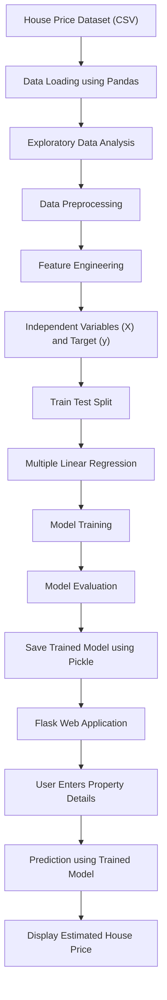
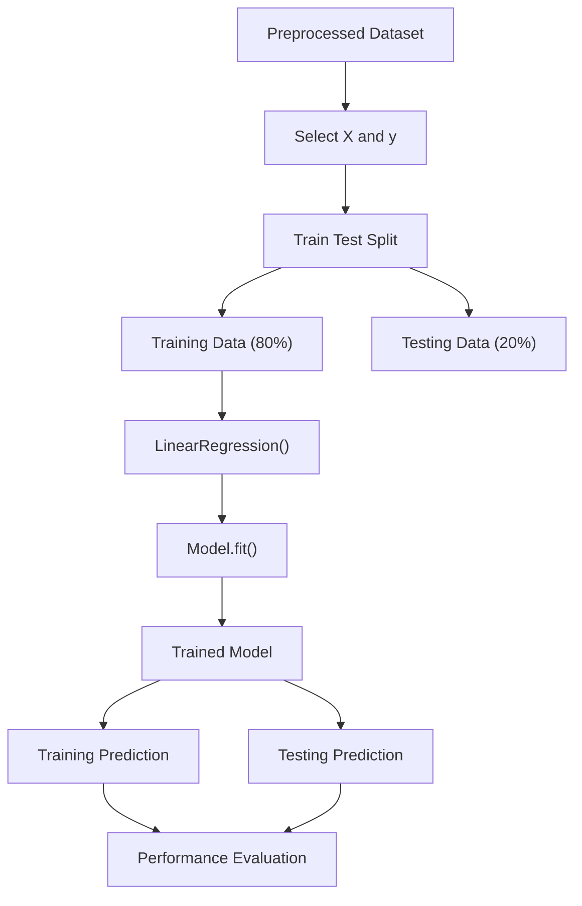
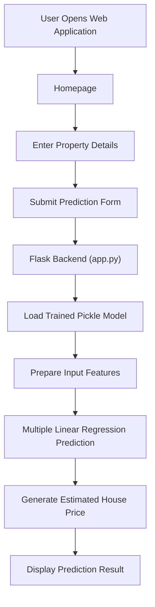

# 🏠 House Price Prediction Using Multiple Linear Regression

<p align="center">
  
  
  
  
  
  
</p>

---

## 📌 Project Overview

**House Price Prediction** is a Machine Learning project developed using the **Multiple Linear Regression algorithm** to estimate residential property prices based on different property characteristics and geographical information.

The project uses historical house sales data to train a Machine Learning model. After training, the model learns the relationship between property features and their corresponding selling prices.

A Flask-based web application is developed to allow users to enter their own property details and receive an estimated house price.

The application provides an interactive interface where users can enter property information, submit the details, and view the predicted property price.

### 🎯 Project Objectives

- Develop a House Price Prediction model using Multiple Linear Regression.
- Analyze residential property information.
- Understand the relationship between independent variables and house prices.
- Perform data preprocessing and feature engineering.
- Train and evaluate the Machine Learning model.
- Save the trained model using Pickle.
- Integrate the Machine Learning model with Flask.
- Develop a user-friendly web application for real-time predictions.

---

## 🏗️ Project Architecture

The following diagram explains the complete workflow of the project, from dataset collection to displaying the predicted house price.



---

## 📂 Project Folder Structure

```text
House_Price_Prediction_using_ML/
│
├── .venv/
│
├── output_screenshoots/
│   ├── Homepage.png
│   ├── Input_Fields.png
│   ├── predict.png
│   └── user_enter.png
│
├── static/
│   └── profile.png.png
│
├── templates/
│   └── index.html
│
├── app.py
│
├── main.py
│
├── Explanation.py
│
├── House_Price_Prediction_Datasets.csv
│
├── House_Price_Prediction_Model.pkl
│
├── README.md
│
└── requirements.txt
```

### 📁 File Description

| File / Folder | Description |
|---|---|
| `.venv/` | Python virtual environment. |
| `output_screenshoots/` | Contains project output screenshots. |
| `static/` | Stores static files such as profile images. |
| `templates/` | Contains the HTML frontend template. |
| `main.py` | Main development file containing the Multiple Linear Regression implementation using OOP concepts. |
| `app.py` | Flask application responsible for handling user inputs and generating predictions. |
| `Explanation.py` | Additional project explanation file. |
| `House_Price_Prediction_Datasets.csv` | Dataset used for training and testing. |
| `House_Price_Prediction_Model.pkl` | Saved trained Machine Learning model. |
| `index.html` | User interface for entering property information. |
| `requirements.txt` | Contains the required Python libraries. |

---

## 📊 Dataset Information

The project uses a residential house sales dataset containing historical property information.

The dataset includes different property characteristics, geographical details, and house selling prices.

### Dataset Features

The following features are used in the prediction process:

| Feature | Description |
|---|---|
| Bedrooms | Number of bedrooms in the property. |
| Bathrooms | Number of bathrooms in the property. |
| Sqft Living | Total living area in square feet. |
| Sqft Lot | Total land area in square feet. |
| Floors | Number of floors in the property. |
| Waterfront | Indicates whether the property has a waterfront view. |
| View | Property view rating. |
| Condition | Overall condition of the property. |
| Sqft Above | Above-ground living area in square feet. |
| Sqft Basement | Basement area in square feet. |
| Year Built | Year in which the property was constructed. |
| Year Renovated | Year in which the property was renovated. |
| Country | Country information. |
| State | State information. |
| Zipcode | Property ZIP code. |

### Target Variable

**Price**

The target variable represents the selling price of the residential property.

### Independent and Dependent Variables

- **Independent Variables (X):** Property characteristics and geographical information.
- **Dependent Variable (y):** House selling price.

---

## 🔍 Exploratory Data Analysis (EDA)

Exploratory Data Analysis (EDA) is an important step in Machine Learning. It helps us understand the dataset before developing the prediction model.

The following data analysis and preprocessing operations are considered in this project.

### 1. Dataset Loading

The dataset is loaded using the Pandas library.

```python
import pandas as pd

df = pd.read_csv("House_Price_Prediction_Datasets.csv")
```

### 2. Dataset Inspection

The dataset can be inspected to understand its structure.

```python
print(df.head())
print(df.shape)
print(df.info())
print(df.describe())
print(df.isnull().sum())
```

### 3. Data Preprocessing

The following preprocessing operations are performed:

- Removing unnecessary columns such as date, street, and city.
- Extracting state and ZIP code from the combined statezip column.
- Converting categorical country and state values into numerical values.
- Separating independent and dependent variables.
- Splitting the dataset into training and testing data.

### 4. Feature Selection

The independent variables contain property information, while the dependent variable contains the actual house price.

This allows the algorithm to learn how different property characteristics influence the selling price.

---

## 🤖 Machine Learning Algorithm

### Multiple Linear Regression

Multiple Linear Regression is a supervised Machine Learning algorithm used to predict a continuous numerical value based on multiple independent variables.

In this project, Multiple Linear Regression is used to estimate house prices using different property features.

### Mathematical Equation

The Multiple Linear Regression equation is:

```text
Y = b0 + b1X1 + b2X2 + b3X3 + ... + bnXn
```

Where:

- Y = Predicted house price.
- b0 = Intercept.
- b1, b2, ..., bn = Regression coefficients.
- X1, X2, ..., Xn = Independent variables.

### How the Algorithm Works

1. The algorithm receives historical house property information.
2. It identifies relationships between property features and selling prices.
3. It calculates regression coefficients.
4. It learns the relationship between independent variables and the target variable.
5. It predicts house prices for new property information.

### Model Training Workflow



### Train-Test Split

The dataset is divided into two parts:

- Training Data: 80%
- Testing Data: 20%

The following function is used:

```python
train_test_split(
    X,
    y,
    test_size=0.2,
    random_state=42
)
```

---

## 📈 Model Evaluation

After training the Multiple Linear Regression model, its performance is evaluated using different evaluation metrics.

### 1. R² Score

R² Score is used to measure how well the model explains the variation in the target variable.

A higher R² score generally indicates better model performance.

```python
from sklearn.metrics import r2_score

r2_score(y_test, test_predict)
```

### 2. Root Mean Squared Error (RMSE)

RMSE measures the average magnitude of prediction errors, giving more weight to larger errors.

A lower RMSE generally indicates better prediction performance.

```python
from sklearn.metrics import root_mean_squared_error

root_mean_squared_error(y_test, test_predict)
```

### Model Performance

The project evaluates the model using:

- Training R² Score.
- Testing R² Score.
- Training RMSE.
- Testing RMSE.

These metrics help understand how well the model performs on both training and unseen testing data.

---

## 💾 Model Saving and Loading

After training, the Machine Learning model is saved using the Pickle library.

This allows the Flask application to load the previously trained model without training it again every time.

### Saving the Model

```python
import pickle

with open("House_Price_Prediction_Model.pkl", "wb") as f:
    pickle.dump(self.reg, f)
```

### Loading the Model

```python
with open("House_Price_Prediction_Model.pkl", "rb") as p:
    model = pickle.load(p)
```

---

## 🌐 Flask Web Application

A Flask web application is developed to make the House Price Prediction model accessible through a graphical user interface.

The application allows users to enter property details and receive estimated house prices.

### Application Workflow



### Main Application Features

- User-friendly web interface.
- Property details input form.
- Property location information.
- Multiple property feature inputs.
- Predict Price button.
- Reset button.
- Random input generation.
- Estimated house price display.
- Machine Learning algorithm information.
- Developer profile and contact information.

---

## 📸 Project Output Screenshots

The following screenshots demonstrate the actual working interface of the House Price Prediction application.

### 1. Homepage

The homepage provides an overview of the House Price Prediction application.

It displays the project title, developer information, property input form, and prediction functionality.

<p align="center">
  
</p>

<p align="center">
  <b>Figure 1:</b> House Price Prediction application homepage.
</p>

---

### 2. Property Input Fields

Users can enter different property details, including:

- Number of bedrooms.
- Number of bathrooms.
- Living area.
- Lot area.
- Number of floors.
- Waterfront property.
- Property view.
- Property condition.
- Above-ground area.
- Basement area.
- Year built.
- Year renovated.
- ZIP code.

<p align="center">
  
</p>

<p align="center">
  <b>Figure 2:</b> Input form for entering residential property details.
</p>

---

### 3. User Entered Property Details

This screenshot demonstrates an example of property information entered by the user before submitting the prediction.

The application accepts property characteristics and geographical information.

<p align="center">
  
</p>

<p align="center">
  <b>Figure 3:</b> Example property information entered by the user.
</p>

---

### 4. House Price Prediction Result

After submitting the property information, the Flask backend passes the input features to the trained Multiple Linear Regression model.

The application displays the estimated property price generated by the Machine Learning model.

The result section also displays:

- Estimated Property Price.
- Machine Learning Algorithm.
- Project Type.
- Project Name.

<p align="center">
  
</p>

<p align="center">
  <b>Figure 4:</b> Estimated house price generated by the Machine Learning model.
</p>

---

## 🛠️ Technologies Used

| Technology | Purpose |
|---|---|
| Python | Main programming language. |
| NumPy | Numerical operations. |
| Pandas | Dataset loading and manipulation. |
| Matplotlib | Data visualization. |
| Scikit-learn | Machine Learning model development. |
| Multiple Linear Regression | House price prediction algorithm. |
| Pickle | Model saving and loading. |
| Flask | Backend web application framework. |
| HTML5 | Webpage structure. |
| CSS3 | Webpage styling. |
| JavaScript | Frontend interactions. |
| Git | Version control. |
| GitHub | Project repository hosting. |
| PyCharm | Python development environment. |

---

## ⚙️ Installation and Execution

Follow the steps below to run this project on your local machine.

### Step 1: Clone the Repository

```bash
git clone https://github.com/yuvatejamadasu/House_Price_Prediction_using_ML.git
```

### Step 2: Navigate to the Project Directory

```bash
cd House_Price_Prediction_using_ML
```

### Step 3: Create a Virtual Environment

```bash
python -m venv .venv
```

### Step 4: Activate the Virtual Environment

For Windows PowerShell:

```powershell
.venv\Scripts\Activate
```

### Step 5: Install Required Libraries

```bash
pip install -r requirements.txt
```

### Step 6: Run the Flask Application

```bash
python app.py
```

### Step 7: Open the Application

Open your browser and visit:

```text
http://127.0.0.1:5000/
```

The House Price Prediction application will be available in your browser.

---

## 🔮 Example Prediction

The following is an example of property information entered through the web application.

| Property Feature | Example Value |
|---|---:|
| Bedrooms | 4 |
| Bathrooms | 2 |
| Living Area | 1800 |
| Lot Area | 5000 |
| Floors | 2 |
| Waterfront | No |
| Property View | 2 - Average |
| Property Condition | 4 - Good |
| Above-Ground Area | 1500 |
| Basement Area | 300 |
| Year Built | 2004 |
| Year Renovated | 2020 |
| ZIP Code | 98001 |
| Country | USA |
| State | WA |

### Example Prediction Output

```text
Estimated Property Price:

$468,463.77
```

**Note:** This is the example output displayed in the project's application screenshot. Actual predictions depend on the property details entered by the user.

---

## 🚀 Future Enhancements

The following improvements can be considered for future versions:

- Implement additional regression algorithms.
- Compare Multiple Linear Regression with other regression models.
- Improve feature engineering and preprocessing.
- Add interactive data visualization.
- Improve prediction accuracy through model optimization.
- Deploy the application on a cloud hosting platform.
- Integrate a database to store prediction history.

---

## 👨‍💻 Developer Information

**Developed by: M. Yuva Teja**

Machine Learning Developer

- GitHub: [yuvatejamadasu](https://github.com/yuvatejamadasu)
- LinkedIn: [Yuva Teja Madasu](https://www.linkedin.com/in/yuva-teja-madasu-241363317/)

---

## ⭐ Support

If you find this project useful, please consider giving this repository a ⭐ on GitHub.

Your support and feedback are appreciated!

---

<p align="center">
  <b>🏠 HOUSE PRICE PREDICTION</b>
  <br>
  Machine Learning | Multiple Linear Regression | Flask
  <br><br>
  Developed by <b>M. Yuva Teja</b>
</p>